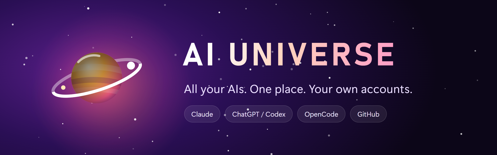
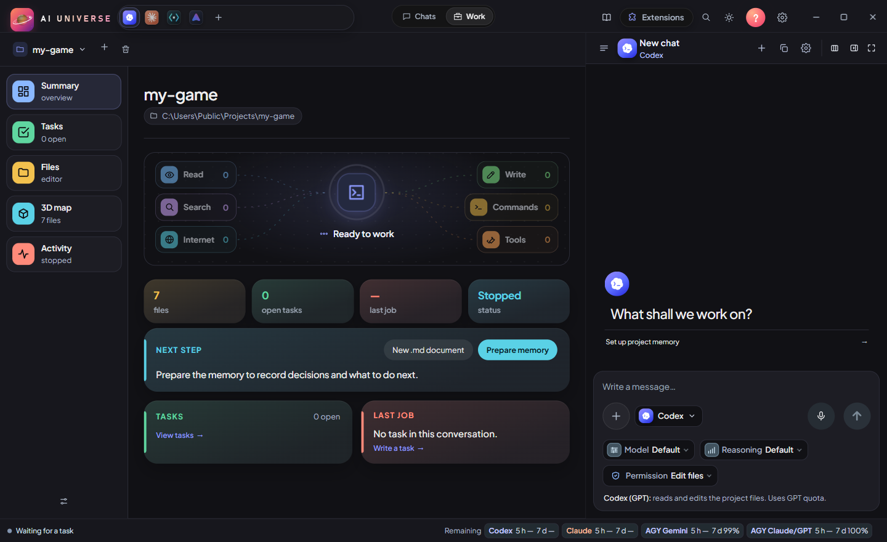
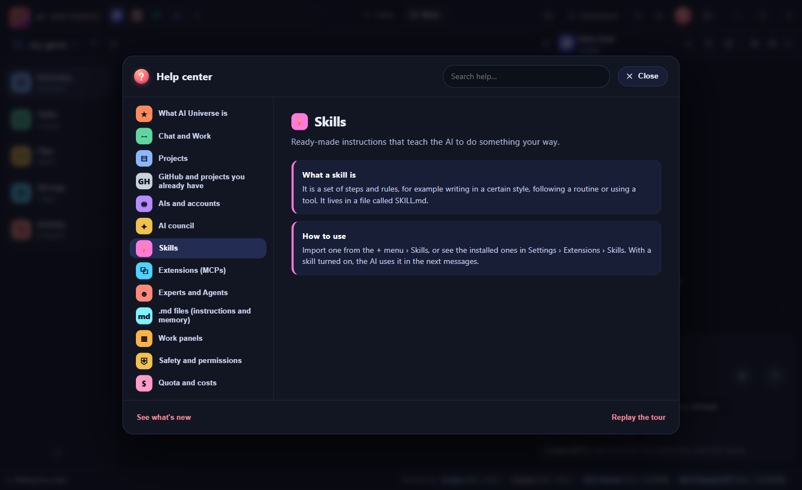
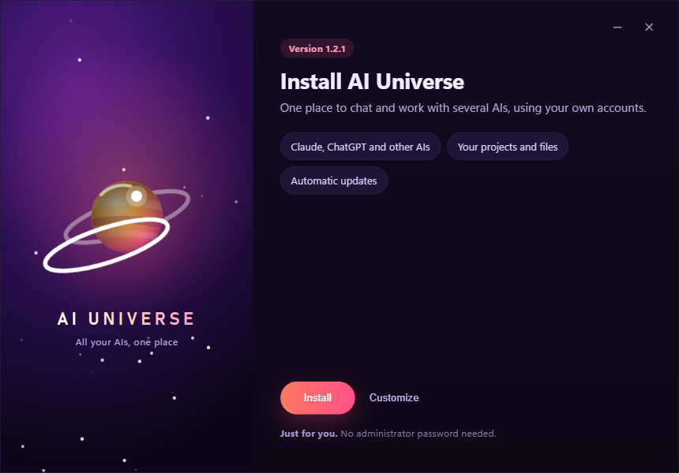

 

# 🪐 AI Universe

### All your AIs. One place. Your own accounts.

Chat and work with **Claude**, **ChatGPT / Codex**, **OpenCode** and more in a single, beautiful Windows app.

 

---

## ✨ What is it?

**AI Universe** is a desktop app that puts the AIs you already pay for in one window. Pick a chat, or point an AI at a project folder and **watch it work live**. No API keys, no extra bill: every AI uses **your own subscription**.

---

## 🚀 Features

| | |
|---|---|
| 💬 **Chat & Work modes** | Just chat, or let an AI read, create and edit files in a project folder (with the permission level you choose). |
| 🔑 **Your own accounts** | Claude, ChatGPT/Codex, OpenCode and others. Add several accounts per AI and switch automatically when a quota runs out. |
| 🧑‍⚖️ **AI council** | Ask several AIs at once and get one combined answer. |
| 🐙 **GitHub built in** | Sign in and continue any of your repositories, private or public, as a project. |
| 📂 **Projects & live activity** | Tasks, a code editor, a 3D map of your project and a step-by-step timeline of what the AI reads, writes and runs. |
| 🧩 **Skills, MCPs & `.md` files** | Teach the AI your way of working and give it new powers. Everything is optional. |
| 🛟 **Help center & first-run tour** | Simple explanations of everything, with a red **?** always one click away. |
| 🌗 **Light & dark themes** | Smooth animations, plus a light mode for low memory use. |
| 🔔 **Tray icon** | Closing the window keeps the app in the tray. Use *Close for good* to quit. |
| 🔄 **Automatic updates** | A friendly pop-up, a safe download (checked with SHA-256) and a *What's new* screen. |
| 🌍 **Languages** | 🇺🇸 English and 🇧🇷 Português. |

&nbsp;

---

## 📥 Install

1. ⬇️ Download **`AI-Universe-Setup-<version>.exe`** from the [**Releases**](../../releases/latest) page.
2. ▶️ Run it and click **Install**. It installs just for you, with **no administrator password**.
3. 🔑 Open **Settings › My AIs** and sign in to the AIs you use.

> 🛡️ Windows may show *"unrecognized app"* because the files are not code-signed yet. Click **More info › Run anyway**.
>
> 🗑️ To remove it: **Settings › Apps › Installed apps › AI Universe › Uninstall**.
>
> ℹ️ `AI-Universe-<version>.exe` (without "Setup") is the program itself, used by the automatic updater. Most people only need the Setup.

---

## 🧰 Requirements

- 🪟 **Windows 10 (1809+) or Windows 11**
- 🌐 **Microsoft Edge WebView2**: built into Windows 11; on Windows 10 the app offers to install it for you
- 🤖 At least one account (Claude or ChatGPT) or a free local AI such as Ollama

---

## 🔒 Privacy & security

- 🏠 The app only talks to `127.0.0.1` (your own computer).
- 🔐 It **never reads** your keys, passwords or cookies: sign-ins happen in each AI's own tool or website.
- 🎚️ You choose how far an AI can go: read only, edit files, run commands, or full access.
- 🧾 Updates are verified with SHA-256 before being installed.

---

## ❓ FAQ

<b>Do I need API keys?</b>

No. AI Universe uses the subscriptions you already have (Claude, ChatGPT...). The app itself is free and charges nothing.

<b>Where is my data?</b>

Only on your computer, in `%LOCALAPPDATA%\AI-Universe-Dados`. Nothing is sent to any server of ours.

<b>How do I update?</b>

You don't have to do anything: the app shows an update pop-up when a new version is out and installs it for you.

---

**Made with 💜 and a lot of ☕**

📄 Licensed under a [proprietary license](LICENSE): free to use, not to copy or redistribute.

