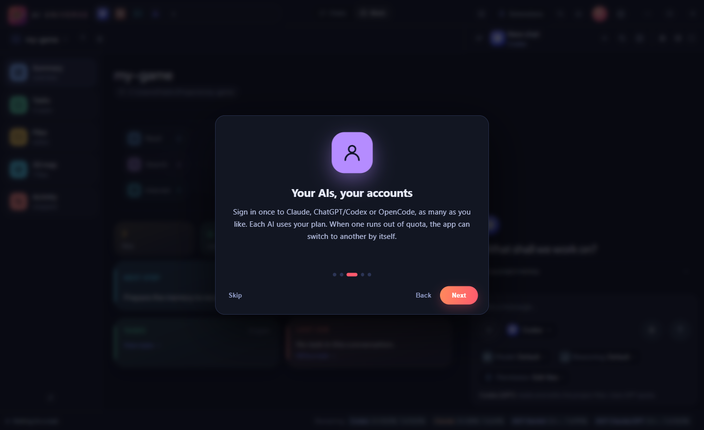
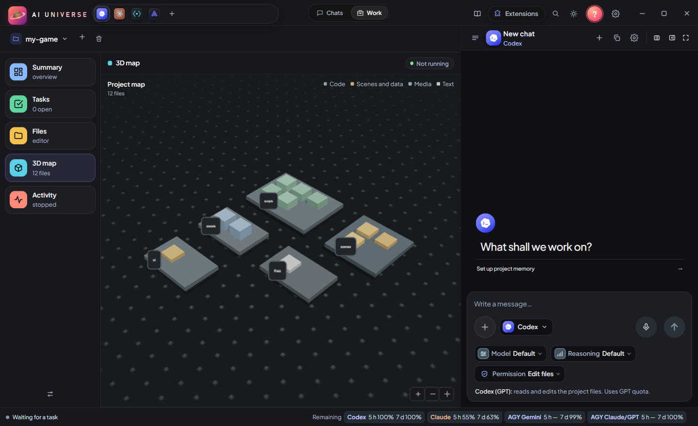
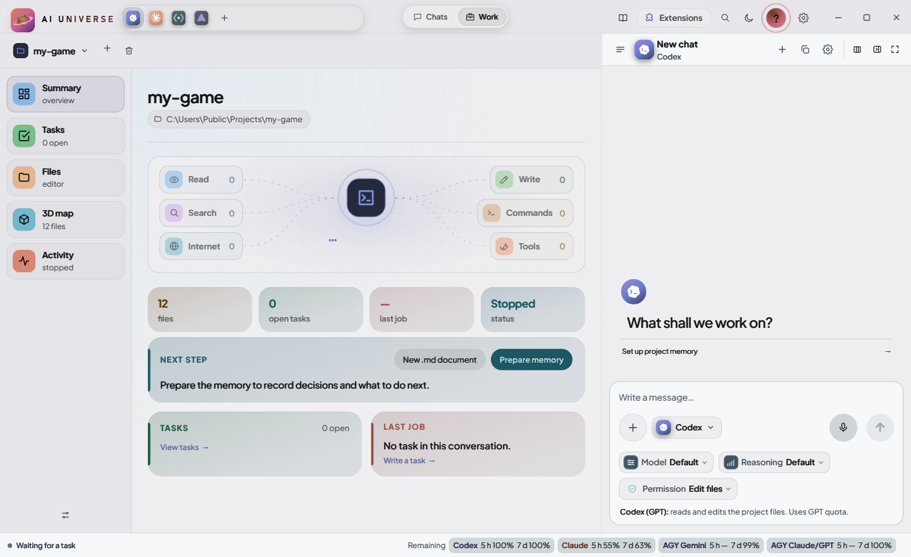
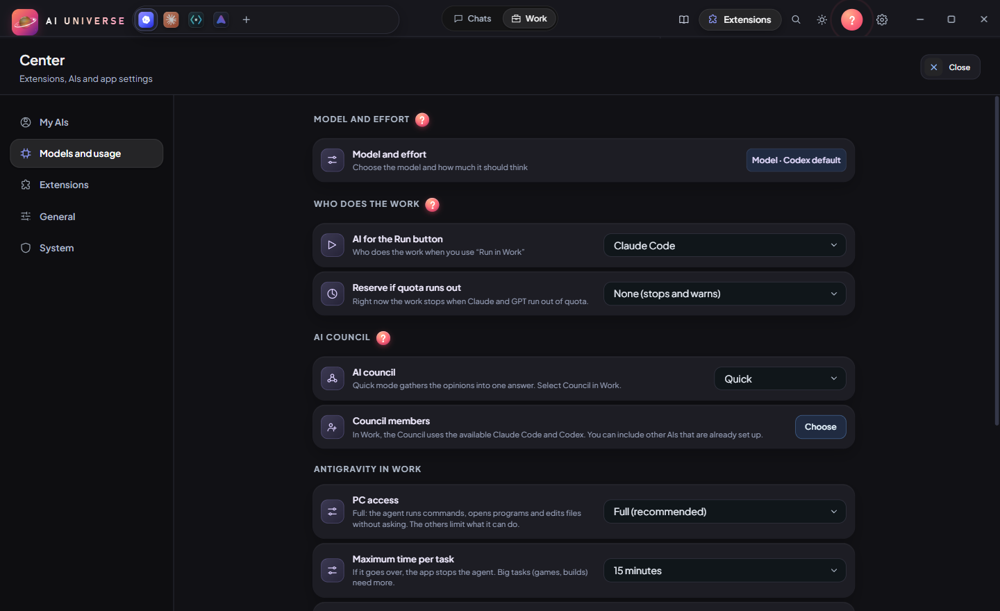
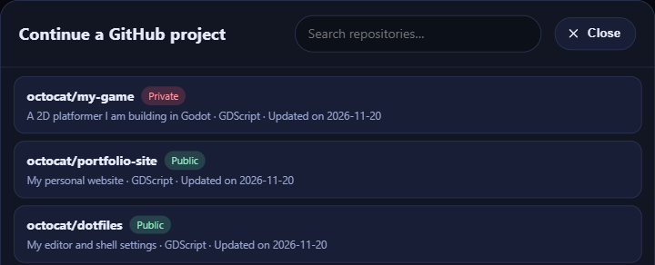
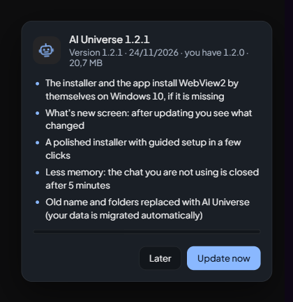
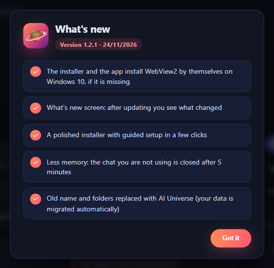
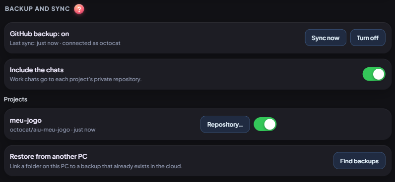
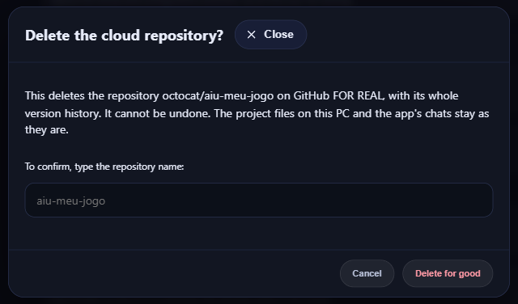

 

# 🪐 AI Universe

### All your AIs. One place. Your own accounts.

Chat and work with **Claude**, **ChatGPT / Codex**, **OpenCode** and more in a single, beautiful Windows program.

 

---

## ✨ What is it?

**AI Universe** is a desktop program that puts the AIs you already pay for in one window. Pick a chat, or point an AI at a project folder and **watch it work live**. No API keys, no extra bill: every AI uses **your own subscription**.

---

## 🚀 Features

| | |
|---|---|
| 💬 **Chat & Work modes** | Just chat, or let an AI read, create and edit files in a project folder (with the permission level you choose). |
| 🔑 **Your own accounts** | Claude, ChatGPT/Codex, OpenCode and others. Add several accounts per AI and switch automatically when a quota runs out. |
| 🧑‍⚖️ **AI council** | Ask several AIs at once and get one combined answer. |
| 🐙 **GitHub built in** | Sign in and continue any of your repositories, private or public, as a project. |
| ☁️ **Cloud backup (optional)** | Back up your chats, tasks and summaries to **private repositories of your own** on GitHub, one per project, and pick up where you left off on another PC. [How it works ↓](#%EF%B8%8F-cloud-backup--sync) |
| 🌐 **Browser for the AI** | OpenCode can open and use websites in **Firefox, Chrome, Edge or Brave**, in a window docked next to AI Universe. |
| 📂 **Projects & live activity** | Tasks, a code editor, a 3D map of your project and a step-by-step timeline of what the AI reads, writes and runs. |
| 🧩 **Skills, MCPs & `.md` files** | Teach the AI your way of working and give it new powers. Everything is optional. |
| 🛟 **Help center & first-run tour** | Simple explanations of everything, with a red **?** always one click away. |
| 🌗 **Light & dark themes** | Smooth animations, plus a light mode for low memory use. |
| 🔔 **Tray icon** | Closing the window keeps AI Universe in the tray. Use *Close for good* to quit. |
| 🔄 **Automatic updates** | A friendly pop-up, a safe download (checked with SHA-256) and a *What's new* screen. |
| 🌍 **Languages** | 🇺🇸 English and 🇧🇷 Português. |

&nbsp;

---

## 🖼️ Gallery

<table>
<tr>
<td align="center"><b>🗺️ 3D map of your project</b> </td>
<td align="center"><b>🌞 Light theme</b> </td>
</tr>
<tr>
<td align="center"><b>🤖 Models & AI council</b> </td>
<td align="center"><b>🐙 Continue a GitHub project</b> </td>
</tr>
<tr>
<td align="center"><b>🔄 Automatic update</b> </td>
<td align="center"><b>🆕 What's new</b> </td>
</tr>
</table>

---

## ☁️ Cloud backup & sync

**Optional and off by default.** Turn it on in **Settings › General › Backup and sync** (you need to be signed in to GitHub). Then your work follows you: reinstall, change PCs, or keep two computers in step.

### How it works

1. 🔐 **You sign in to GitHub** (the same sign-in AI Universe already uses). It never sees your password.
2. 📦 **One private repository per project.** Turn a project on and AI Universe creates a **private** repository named `aiu-<project>` in **your own** GitHub account, plus `aiu-config` for your settings and chats that don't belong to a project.
3. 🔄 **It syncs by itself** in the background, or on demand with **Sync now**. Every sync is a normal Git commit, so you also get a **version history** for free.
4. 💻 **On another PC:** install AI Universe, sign in, turn on the backup and use **Find backups** to link a folder of that PC to each backup. Your chats and tasks come back.

### What goes to the cloud, and what stays on your PC

| ☁️ Goes to your private repositories | 🏠 Always stays on your PC |
|---|---|
| Work chats (you can switch this off) | Your project files (they stay where they are) |
| Tasks and the project summary | Images, audio, 3D models and builds |
| A few settings and AI preferences | Sign-ins, tokens, passwords and e-mails |
| | Usage numbers, permission level and local paths |

Heavy files never go up, so a big game doesn't turn into a huge repository. To back up your project files too, use Git on the project itself, as you normally would.

### Two PCs, no surprises

If the **same thing changed on both computers**, AI Universe **does not overwrite anything**. It shows both versions and you choose to keep this PC's, the cloud's, or both.

### Archive or delete from AI Universe

Open a project's **Repository…** to **archive** its cloud repository (read-only, reversible on GitHub) or **delete it for good**.

- 🛡️ Deleting is **permanent** and needs an **extra permission** from GitHub, which you approve in your browser, plus **typing the repository name** to confirm.
- 🎯 AI Universe only touches repositories **it created itself**. It never deletes your other repositories, and never your project files.

### Good to know

- 💸 **Free:** personal GitHub accounts can have unlimited private repositories.
- 🔒 **Private, not encrypted:** your data sits in your private repositories, protected by your GitHub account. AI Universe checks that each repository is really private before every sync and refuses to use a public one. It also tries to warn about things that look like secrets, but **don't paste passwords or API keys into chats**.
- 🧪 This feature is new. Tell us if something looks odd.

---

## 📥 Install

1. ⬇️ Download **`AI-Universe-Setup-<version>.exe`** from the [**Releases**](../../releases/latest) page.
2. ▶️ Run it and click **Install**. It installs just for you, with **no administrator password**.
3. 🔑 Open **Settings › My AIs** and sign in to the AIs you use.

> 🛡️ Windows may show *"unrecognized app"* because the files are not code-signed yet. Click **More info › Run anyway**.
>
> 🗑️ To remove it: **Settings › Apps › Installed apps › AI Universe › Uninstall**.
>
> ℹ️ `AI-Universe-<version>.exe` (without "Setup") is the program itself, used by the automatic updater. Most people only need the Setup.

---

## 🧰 Requirements

- 🪟 **Windows 10 (1809+) or Windows 11**
- 🌐 **Microsoft Edge WebView2**: built into Windows 11; on Windows 10 AI Universe offers to install it for you
- 🤖 At least one account (Claude or ChatGPT) or a free local AI such as Ollama

---

## 🔒 Privacy & security

- 🏠 **Your chats, projects and settings stay on your computer**, in `%LOCALAPPDATA%\AI-Universe-Dados`. Nothing is uploaded to any server of ours (we don't run any). The only way your data leaves your PC is the optional [cloud backup](#%EF%B8%8F-cloud-backup--sync), and then it goes **only to private repositories in your own GitHub account**.
- 🌐 **AI Universe does connect to the internet, only for what you use:**
  - the AIs you sign in to (through each AI's own tool or website);
  - checking for updates (it reads a small file from this GitHub repository and downloads the new version from its Releases);
  - GitHub, only if you sign in (through the official GitHub CLI), and for the cloud backup if you turn it on;
  - Microsoft's WebView2 download, only on Windows 10 when it is missing.
- 📊 **No analytics or telemetry:** we found no code that sends usage data anywhere.
- 🔐 It **never reads** your keys, passwords or cookies: sign-ins happen in each AI's own tool or website.
- 🎚️ You choose how far an AI can go: read only, edit files, run commands, or full access.
- 🧾 Updates are verified with SHA-256 before being installed.

> ⚠️ Your messages go to the AI you choose, under that AI's own privacy policy. Don't paste secrets (passwords, API keys) into a chat.

---

## ❓ FAQ

<b>Do I need API keys?</b>

No. AI Universe uses the subscriptions you already have (Claude, ChatGPT...). AI Universe itself is free and charges nothing. (API keys are optional and only for a few extra providers.)

<b>Can I use it on two computers?</b>

Yes. Turn on the [cloud backup](#%EF%B8%8F-cloud-backup--sync) on both: your chats, tasks and summaries follow you through private repositories in your own GitHub account. Each computer still has its own sign-ins, and your project files stay where they are (bring them with Git or however you prefer).

<b>Where is my data?</b>

On your computer, in `%LOCALAPPDATA%\AI-Universe-Dados`. Nothing is sent to any server of ours. If you turn on the optional cloud backup, a copy of your chats, tasks and summaries also lives in private repositories of your own GitHub account.

<b>Is the cloud backup free? Is there a limit?</b>

It's free: personal GitHub accounts can have unlimited private repositories. It uses one per project plus one for settings.

<b>Can I delete the cloud backup?</b>

Yes, from AI Universe: **Repository… › Delete for good**. It asks for an extra GitHub permission and for you to type the repository name. Only repositories created by AI Universe can be deleted, and your project files are never touched.

<b>How do I update?</b>

You don't have to do anything: AI Universe shows an update pop-up when a new version is out and installs it for you.

---

**Made with 💜 and a lot of ☕**

📄 Licensed under a [proprietary license](LICENSE): free to use, not to copy or redistribute.

